# Lab2：Bomb Lab 实验报告

- 实验日期：2026 年 10 月 13—14 日
- 仓库：https://github.com/10xmx012/ics-2026-bomblab
- 环境：Windows、WSL Ubuntu、Linux x86-64、VS Code；使用 GCC、Make、GNU objdump、GDB 和 Python 3。

## 1. 完成情况与方法

已实现六个正式关卡和 Honor。最终 `make test` 输出正式关卡 `Public tests: 60/60`、Honor `Secret public tests: 10/10`。公开测试通过不等于已取得隐藏测试的最终成绩。

使用 objdump 阅读个人 bomb 的关卡和辅助函数，按照 Linux x86-64 参数传递约定追踪寄存器。使用 GDB 查看第 3 关跳转表、第 5 关节点和第 6 关函数指针表。在 tutor 中通过断点核对 challenge、计算期望值与输入值。将恢复出的计算关系写入 `defuser.c`，保存并重新编译后验证。

以下公式中的 `C` 表示当前关卡的 challenge。除明确的 64 位移位外，结果和中间整数均按 32 位无符号数处理，超出范围保留低 32 位。`^` 表示按位异或；`&` 表示按位与；不是数学乘方和逻辑与。

## 2. 第 1 关：函数调用与参数传递

`phase_01` 检查一个无符号整数。输入保存到 `rbp-0x14`，challenge 保存到 r12；调用 `p1_compute` 后，将 eax 与输入比较。

关键调用序列：

```asm
mov %r12,%rdi
call p1_compute
cmp %eax,-0x14(%rbp)
sete %al
```

`p1_compute` 拆出：

```c
L = (uint32_t)C;
H = (uint32_t)(C >> 32);
M = (uint32_t)(C >> 16);
```

三个辅助函数的关键指令和恢复结果：

| 函数 | 关键汇编 | 计算关系 |
|---|---|---|
| p1_step0 | `lea (%rdi,%rsi,4),%eax`；`xor $0x2d73,%eax` | `a = (L + 4*H) ^ 0x2D73` |
| p1_step1 | `xor $0xa6bf,%esi`；`lea (%rsi,%rdi,8),%eax` | `b = (M ^ 0xA6BF) + 8*H` |
| p1_step2 | `lea (%rdi,%rdi,4),%eax`；`add %esi,%eax`；`xor $0xe6a6,%eax` | `c = (5*b + L) ^ 0xE6A6` |

主函数最后执行 `xor %ecx,%eax`。检查三个辅助函数后确认它们没有改写保存 a 的 ecx，因此最终输出为 `c ^ a`。实现时使用 `uint32_t`，输出字段数为 1。

公开测试通过截图：

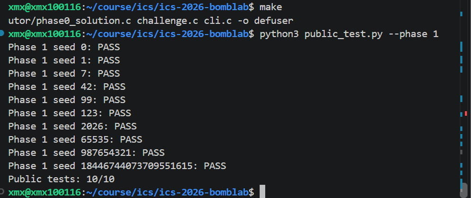

seed 43 的单关运行截图显示命令和 challenge，但下方结果未完整截入；其通过记录由第 9 节 seed 43 完整运行中六关全通过的状态栏补充。

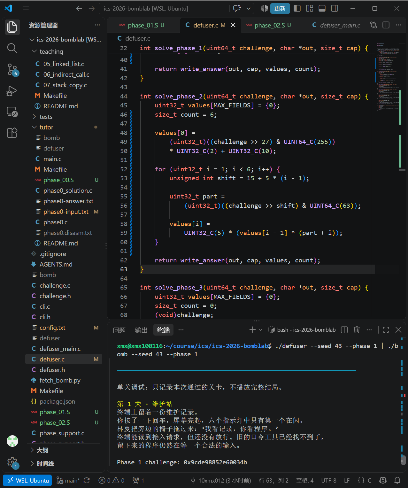

## 3. 第 2 关：数组、循环与递推

`phase_02` 解析六个整数，连续存放在 `rbp-0x40` 至 `rbp-0x2c`，每项 4 字节。

首项计算的关键汇编：

```asm
shr $0x1b,%rax
add %eax,%eax
and $0x1fe,%eax
add $0xa,%eax
```

`0x1B=27`，`0x1FE=510`，`0xA=10`。翻倍后与 510 按位与，等价于翻倍前取低 8 位。因此：

```c
v[0] = ((C >> 27) & 255) * 2 + 10;
```

循环关键部分：

```asm
shr %cl,%rax
and $0x3f,%eax
add %edx,%eax
xor %esi,%eax
mov -0x40(%rbp,%rdx,4),%esi
lea (%rax,%rax,4),%eax
```

edx 初值为 1，每轮加 1；ecx 初值为 15，每轮加 5。esi 在每轮计算开始时保存前一个输入；上一轮已检查通过，故它可用作递推项。

对 `i=1..5`：

```c
shift = 15 + 5 * (i - 1);
part = (C >> shift) & 63;
v[i] = 5 * (v[i - 1] ^ (part + i));
```

移位次数依次是 15、20、25、30、35。实现保留了“先加 i，再异或前项，最后乘 5”的运算顺序，输出六项。

下面截图保留了 seed 43 的运行命令及实现过程，但没有截入通过提示。通过结果见第 9 节完整运行记录。

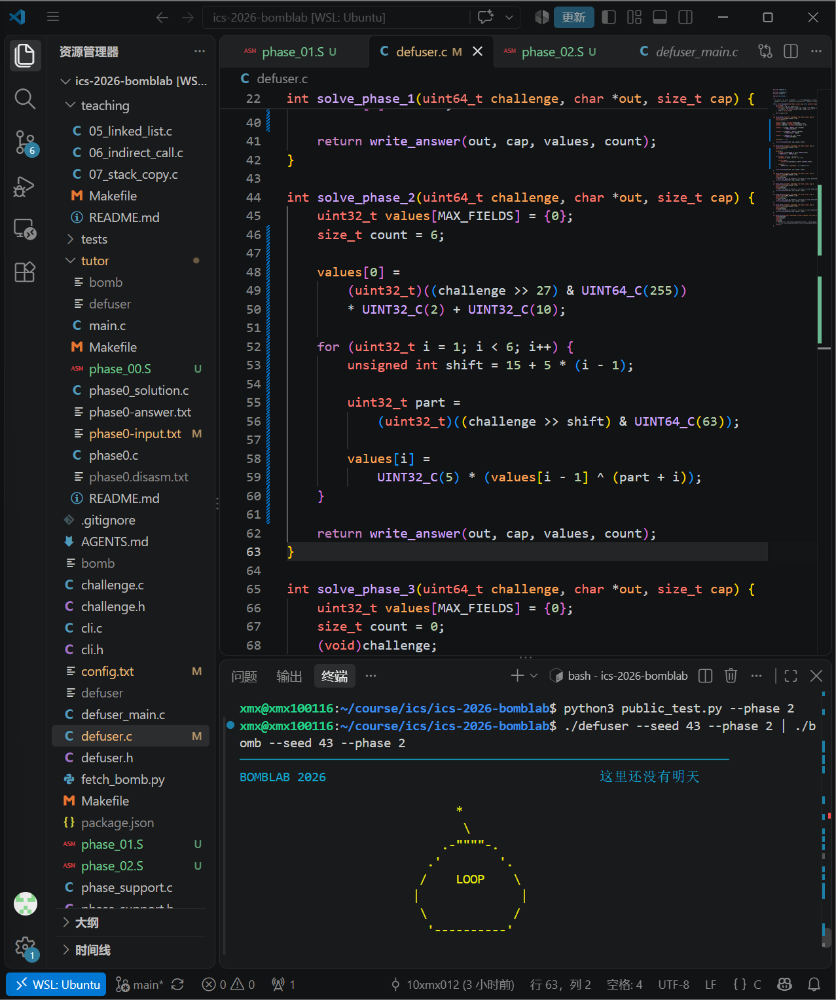

## 4. 第 3 关：switch 与跳转表

输入包含分支编号和分支结果：

```c
index = (uint32_t)C & 7;
x = (uint32_t)(C >> 3) ^ (uint32_t)(C >> 32);
```

`p3_dispatch` 先保存编号，将 x 放入 edi，然后执行间接跳转：

```asm
mov %edi,%eax
mov %esi,%edi
cmp $0x7,%eax
ja ...
notrack jmp *0x405820(,%rax,8)
```

在 GDB 中使用 `x/8gx 0x405820` 查看八个表项。表项顺序决定编号映射，不能按分支在反汇编中的出现顺序推断。

| 输入编号 | 表中目标地址 | 分支函数 | 恢复公式 |
|---:|---|---|---|
| 0 | 0x402278 | p3_case_0 | `5*x + 0x34990` |
| 1 | 0x402280 | p3_case_2 | `3*x + 0xB4B` |
| 2 | 0x402288 | p3_case_3 | `(x ^ 0x733C) + (x >> 1)` |
| 3 | 0x402290 | p3_case_1 | `(4*x) ^ 0xEE2` |
| 4 | 0x402298 | p3_case_4 | `(4*x) ^ 0x5000` |
| 5 | 0x4022a0 | p3_case_7 | `5*x + 0x42CCF` |
| 6 | 0x402268 | p3_case_5 | `3*x + 0x56CC` |
| 7 | 0x402270 | p3_case_6 | `(x ^ 0xCA25) + (x >> 2)` |

第 4 个编号所选分支中 `xor $0x50,%ah` 操作的是 eax 的第 8—15 位，等价于对完整数异或 `0x5000`，而非 `0x50`。解法用 switch 表达表中对应关系，输出编号和结果。

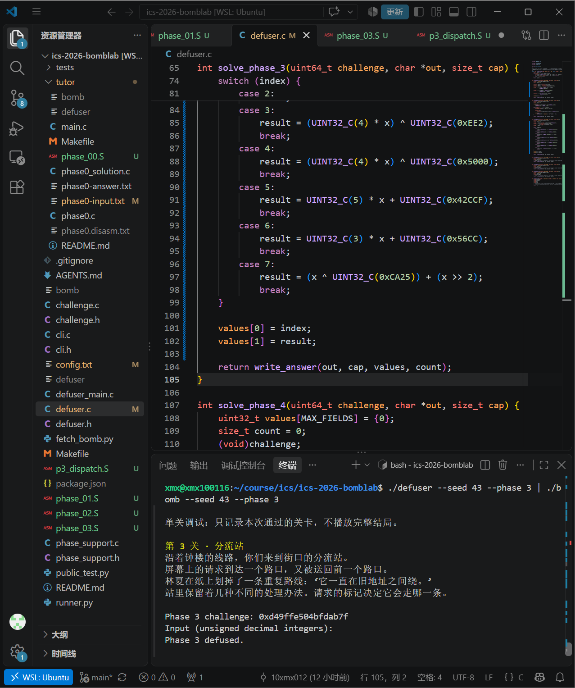

## 5. 第 4 关：递归搜索与返回值组合

调用参数：

```c
target = (uint32_t)C & 127;
key = (uint32_t)(C >> 7) ^ (uint32_t)(C >> 32);
answer = walk(target, 0, 127, key);
```

`p4_walk` 开头通过减法、逻辑右移和加法得到：

```c
mid = low + ((high - low) >> 1);
```

目标等于 mid 时，执行 `lea 0x56(%rdi),%eax` 与 `xor %ecx,%eax`，返回 `(mid + 86) ^ key`。

目标小于 mid 时，用 `lea -0x1(%rdi),%edx` 将下一层 high 改为 mid-1；目标大于 mid 时，用 `lea 0x1(%rdi),%esi` 将下一层 low 改为 mid+1。

返回阶段先执行 `lea (%rax,%rax,4),%eax` 将递归结果乘 5，再异或保存在 ebx 中的 `mid + key`。左分支最后异或 12，右分支最后异或 11：

```c
if (target == mid)
    return (mid + 86) ^ key;
if (target < mid)
    return 5 * walk(target, low, mid - 1, key)
           ^ (mid + key) ^ 12;
return 5 * walk(target, mid + 1, high, key)
       ^ (mid + key) ^ 11;
```

实现时分别处理向下调用的区间变化和向上返回的计算，避免只求出基础值却遗漏返回阶段。target 在初始区间内，每次缩小区间，递归能终止。

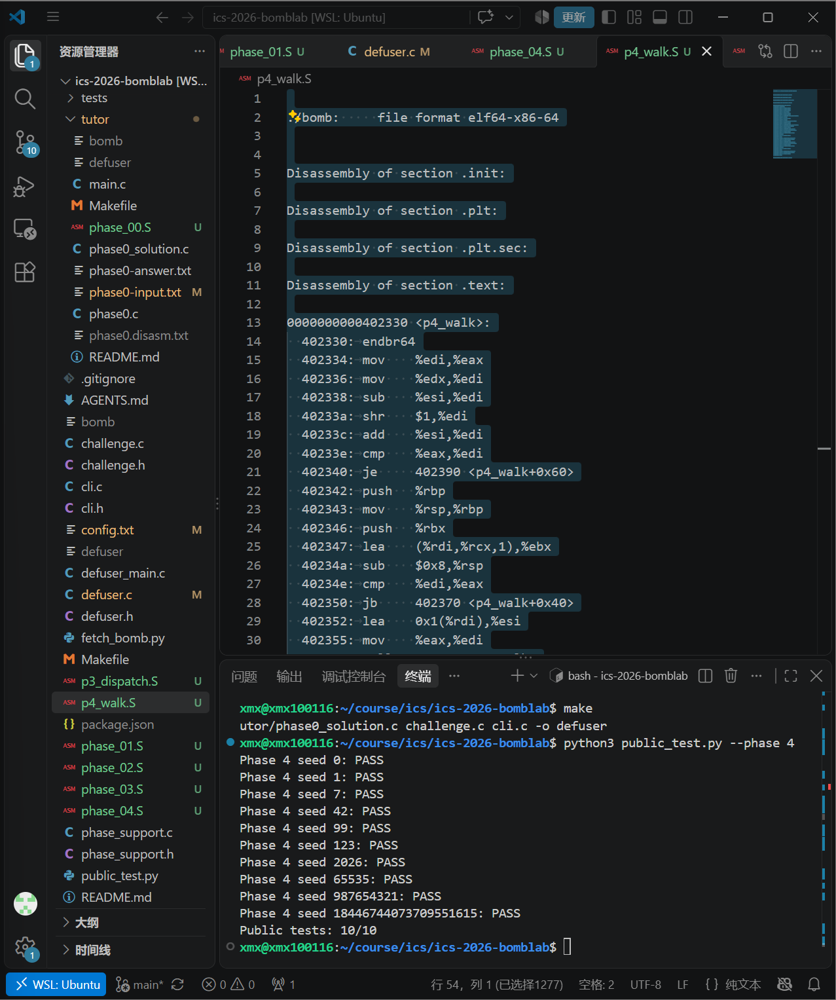

seed 43 的通过结果见第 9 节；此前单关运行也显示 `Phase 4 defused.`。

## 6. 第 5 关：结构体与链表

`p5_traverse` 的内存访问揭示节点布局：偏移 0 为 32 位 value，偏移 4 为 32 位 id，偏移 8 为 64 位 next 指针。

关键指令：

```asm
mov 0x405b60(,%rax,8),%rdx
mov 0x4(%rdx),%esi
add (%rdx),%eax
xor %esi,%eax
mov 0x8(%rdx),%rdx
mov %esi,(%r8)
```

GDB 中使用 `x/8gx 0x405b60` 读取起点表，使用 `x/24gx 0x405ba0` 读取十二个节点。小端序下，每个节点前一个 8 字节数据的低 32 位为 value、高 32 位为 id。

| 节点下标 | 地址 | value | id | next 下标 |
|---:|---|---|---|---:|
| 0 | 0x405ba0 | 0x8A80 | 0x668 | 6 |
| 1 | 0x405bb0 | 0x806A | 0x468 | 2 |
| 2 | 0x405bc0 | 0xC582 | 0x26F | 8 |
| 3 | 0x405bd0 | 0x7E5C | 0x743 | 0 |
| 4 | 0x405be0 | 0x8385 | 0xB36 | 9 |
| 5 | 0x405bf0 | 0x5A45 | 0x125 | 11 |
| 6 | 0x405c00 | 0x867F | 0x877 | 7 |
| 7 | 0x405c10 | 0xFFC7 | 0x307 | 5 |
| 8 | 0x405c20 | 0x7B89 | 0x92F | 10 |
| 9 | 0x405c30 | 0x32A6 | 0x00D | 1 |
| 10 | 0x405c40 | 0x03D7 | 0xA68 | 无 |
| 11 | 0x405c50 | 0x44A5 | 0x568 | 4 |

起点表对应节点下标 `{3, 0, 6, 7, 5, 11, 4, 9}`。

```c
start = (uint32_t)C & 7;
steps = (uint32_t)(C >> 3) & 3;
acc = (uint32_t)(C >> 6) ^ (uint32_t)(C >> 32) ^ 0xBB91;
```

先处理起点，然后沿 next 前进 steps 次。每个节点执行 `acc = (3*acc + value) ^ id`。输出为最终 acc 和最后处理的节点 id。处理的节点总数是 steps+1，不能少算起点。

解法用固定节点数组和 next 下标重现链接关系，固定数据来自个人炸弹，并非公开 seed 的答案表。

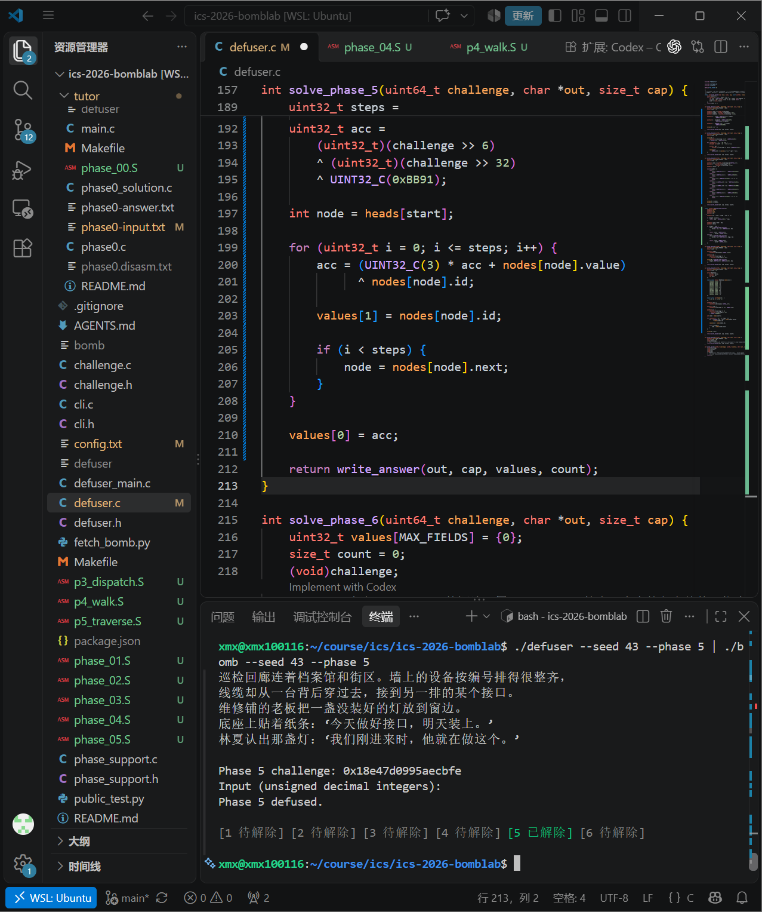

## 7. 第 6 关：函数指针表与间接调用

`p6_dispatch` 有两次间接调用：

```asm
call *0x405e00(,%rax,8)
xor $0xd16a,%eax
mov %eax,%edi
call *0x405e00(%rbx)
add $0x95bc,%eax
```

第一次编号是 `C & 7`。第二次的字节偏移为 `C & 0x38`，等价于 `8*((C >> 3) & 7)`。

```c
i = (uint32_t)C & 7;
j = (uint32_t)(C >> 3) & 7;
x = (uint32_t)(C >> 6) ^ (uint32_t)(C >> 32);
answer = op[j](op[i](x) ^ 0xD16A) + 0x95BC;
```

GDB 使用 `x/8gx 0x405e00` 确认表项。八项指向六个不同函数：

| 表中编号 | 地址 / 函数 | 公式 |
|---:|---|---|
| 0 | 0x402500 / p6_op_1 | `(2*x + 0xD069) ^ (7*x)` |
| 1、2 | 0x402520 / p6_op_2 | `(x >> 1) \| (x << 31)` |
| 3 | 0x4024f0 / p6_op_0 | `(x + 0x7ABC) ^ (x >> 5)` |
| 4、5 | 0x402540 / p6_op_4 | `((x >> 1) ^ x) + 0x79D8` |
| 6 | 0x402550 / p6_op_5 | `((x << 1) \| (x >> 31)) ^ 0xF26B` |
| 7 | 0x402530 / p6_op_3 | `(x ^ 0x57B7) + 4*x` |

`ror $1,%eax` 和 `rol $1,%eax` 分别是 32 位循环右移、循环左移，丢到一端的位要绕回另一端，不能按普通移位实现。解法用 switch 辅助函数表达表中的运算选择。

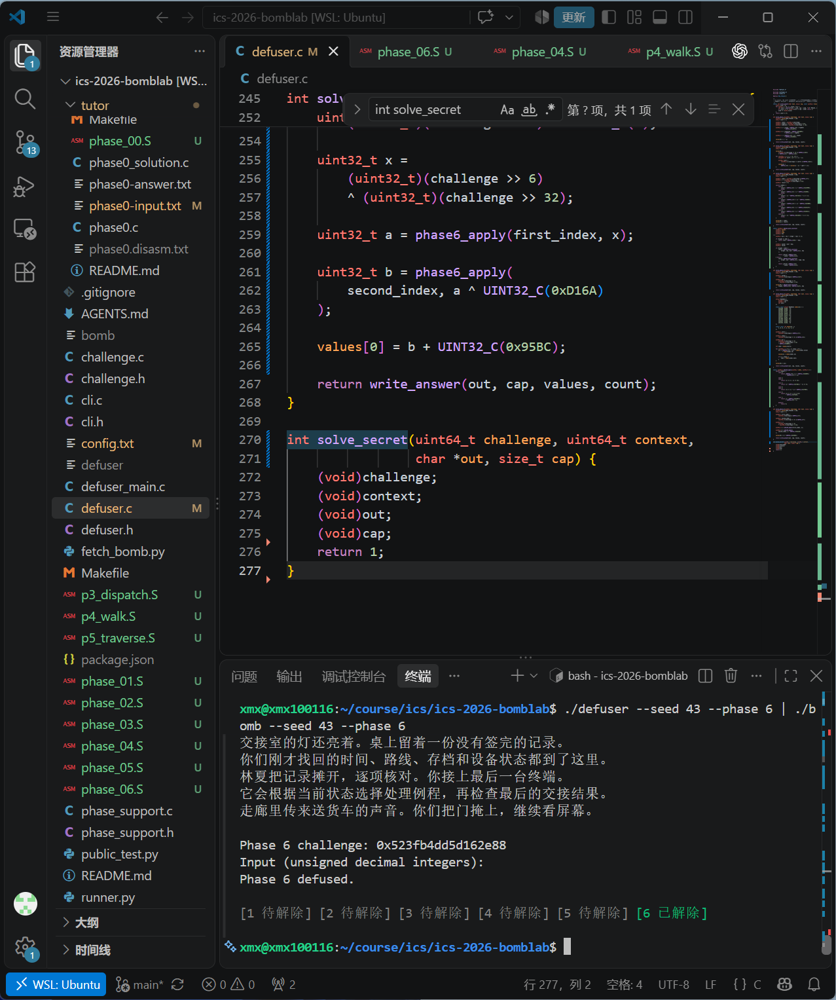

## 8. Honor：局部对象布局与混合计算

### 8.1 文本入口

`secret_gate` 检查长度，`strlen` 后执行 `sub $0x24,%rax`、`cmp $0x7f,%rax` 和无符号 `jbe`，允许字符串长度 36—163 字节。

复制目标起点为 `rbp-0xD0`。`secret_copy` 逐字节复制，遇到并复制 `\0` 后停止。随后检查：

```asm
cmpl $0x4e45504f,-0xb0(%rbp)
lea -0xac(%rbp),%rdi
call secret_phase
```

检查位置距起点 32 字节，小端序下 `0x4E45504F` 是字节串 `OPEN`。后续检查文本从偏移 36 开始。因此求解输出为 32 个 ASCII 字符 A、OPEN、三个空格分隔的无符号十进制整数；不含换行。

该过程按照题目设计满足局部数据字段检查，不涉及覆盖返回地址或执行 shellcode。

### 8.2 三个整数

设 Honor challenge 为 C，context 为 K。context 由驱动根据前六行口令生成，求解函数直接使用传入参数。

```c
index = (uint32_t)K & 3;
a = (uint32_t)C ^ (uint32_t)(C >> 32);
b = (uint32_t)K ^ (uint32_t)(K >> 32);
extra = (index * 0x223B) ^ (uint32_t)(K >> 16);
x = a ^ b;
```

`secret_mix` 关键指令：

```asm
mov %edi,%eax
xor $0x223b,%edi
shr $1,%eax
xor $0x5986,%eax
add %edi,%eax
```

恢复为 `mix(x) = ((x >> 1) ^ 0x5986) + (x ^ 0x223B)`。它不修改 secret_phase 后面使用的 esi、r8、ecx、r9。最终三个整数为：

```c
first = index;
second = mix(x) ^ extra;
third = second ^ (b + index + 0x5986 + (a >> 1));
```

使用 snprintf 写入完整文本，并检查返回值是否为负或是否达到 cap，避免截断。Honor 未实现时保留占位函数以满足链接接口；完成后替换占位实现。

Honor 公开测试通过截图见下一节。

## 9. 测试与截图记录

### 9.1 完整公开测试

执行 `make test`，正式六关 60/60、Honor 10/10。十个公开 seed 为 0、1、7、42、99、123、2026、65535、987654321、18446744073709551615。

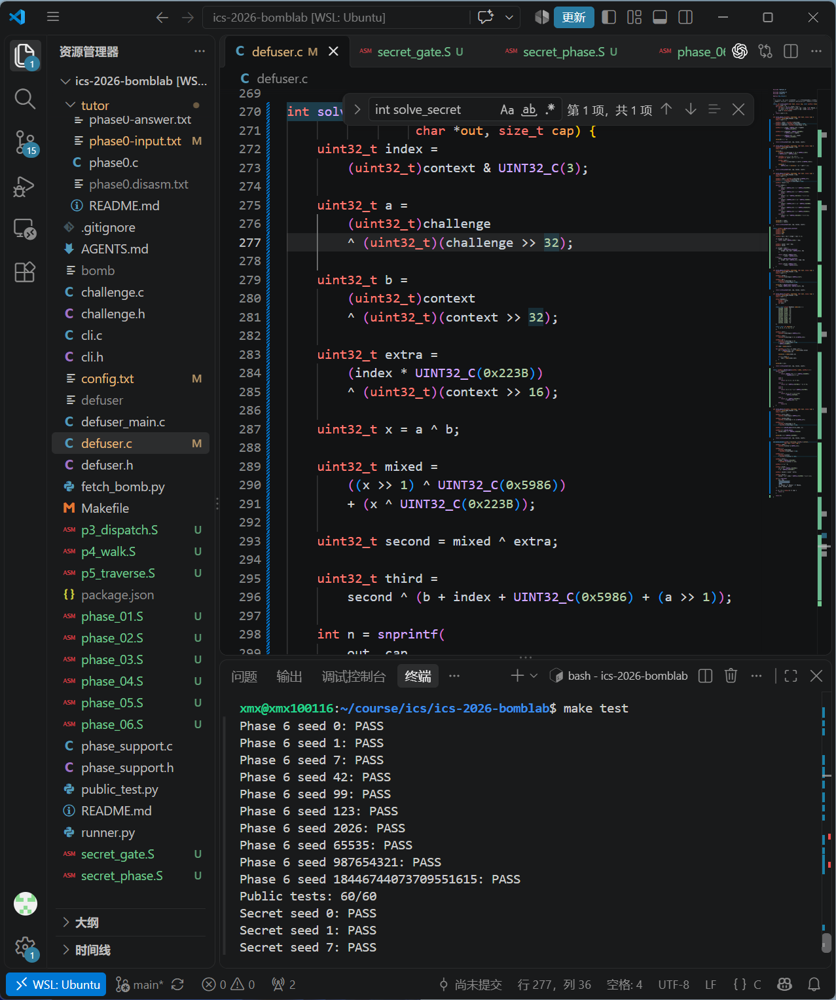

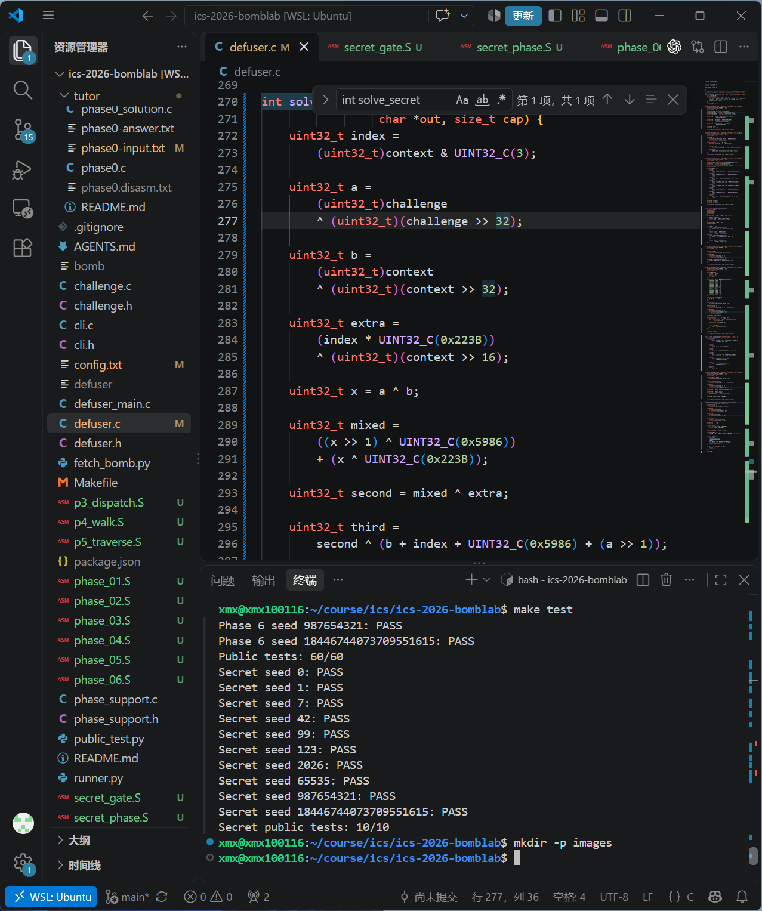

### 9.2 公开列表之外的 seed 43

完整运行使用：

```bash
{
    ./defuser --seed 43
    ./defuser --secret --seed 43
} | ./bomb --seed 43
```

所提供截图显示该命令、六关均已解除的状态栏，以及 `Congratulations! You've defused the bomb.` / `[SAFE] 六项检查全部通过。新档已启用。`。据此记录正式六关在 seed 43 下均通过。

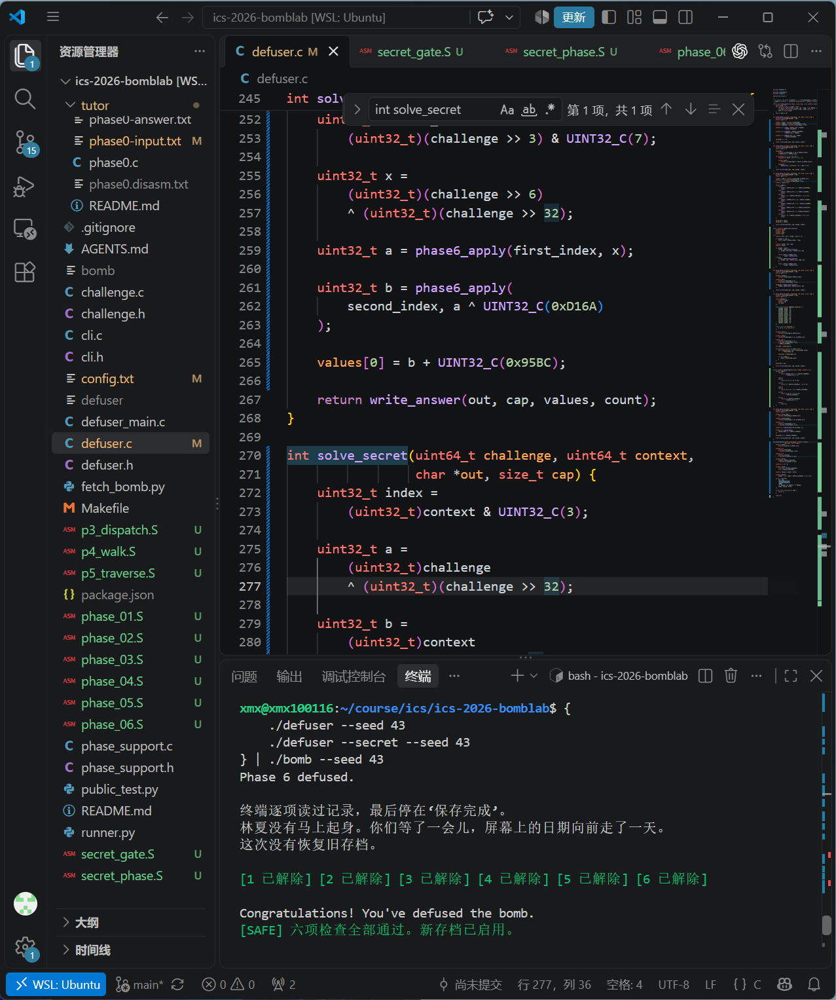

| 关卡 | 公开测试 | 公开列表之外的验证记录 |
|---|---|---|
| 第1关 | 10/10 | seed43完整运行六关全通过 |
| 第2关 | 10/10 | seed43完整运行六关全通过 |
| 第3关 | 10/10 | seed43单关及完整运行通过 |
| 第4关 | 10/10 | seed43完整运行六关全通过 |
| 第5关 | 10/10 | seed43单关及完整运行通过 |
| 第6关 | 10/10 | seed43单关及完整运行通过 |
| Honor | 10/10 | seed43文件输入验证，显示Secret phase defused. |

另外将七行口令写入文件并运行，补充确认 Honor：

```bash
./defuser --seed 43 > verify43.txt
./defuser --secret --seed 43 >> verify43.txt
./bomb --seed 43 < verify43.txt
```

下面的截图包含 `./bomb --seed 43 < verify43.txt` 命令、`Secret phase defused.` 和附加档案恢复提示，确认 Honor 在公开列表之外的 seed43 下通过。verify43.txt 仅用于验证，不作为解法提交。

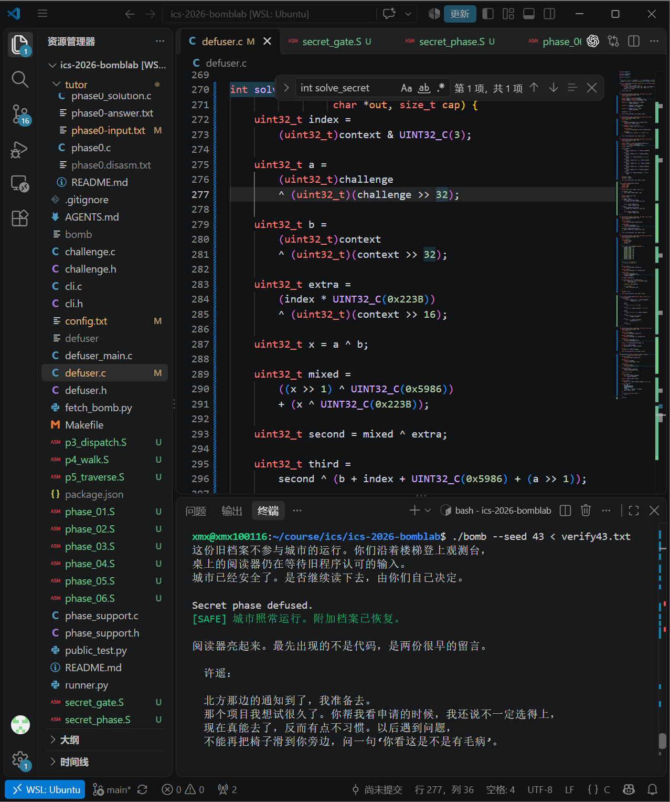

### 9.3 其余过程截图

下图补充第2关实现和调试过程，不将未截入的通过提示当作图片证据：


## 10. 遇到的问题

1. **GDB 显示 No registers。** 需要运行程序并在断点停下，才能查看运行现场；静态表数据可以不 run 直接读取。
2. **分页提示与命令提示符混淆。** 在分页提示处先继续输出，回到 `(gdb)` 后再输入新命令。
3. **修改源码但忘记保存。** make 判断没有新改动，旧可执行文件继续运行；保存并重新编译后，Honor 从 solver_error 变为通过。
4. **链接缺少 solve_secret。** 编辑第6关时缺少 Honor 接口实现，出现 undefined reference；先恢复占位函数，之后实现真实解法。
5. **编号与函数名不同。** 第3、6关按读取的表项顺序建立对应关系，未将函数名数字直接当作选择编号。

## 11. 参考资料与辅助工具使用说明

- 课程实验文档：https://ics-26fall-fdu.github.io/labs/lab2-bomb-lab/
- 课程学生模板：https://github.com/ICS-26Fall-FDU/BombLab
- Bryant、O'Hallaron：《深入理解计算机系统》第三版，第2、3章。
- GDB 官方文档：https://www.sourceware.org/gdb/documentation/
- CSAPP GDB 速查表：https://csapp.cs.cmu.edu/3e/docs/gdbnotes-x86-64.pdf
- ChatGPT / Codex 辅助：2026年10月13—14日，用于解释本人导出的汇编、梳理寄存器和表项对应、协助推导公式与编写 C 实现、排查保存和链接问题，以及整理报告。解法代码包含 AI 辅助生成内容；实验中的命令、编辑、编译和测试由本人在本地执行。报告整理同样使用了 AI 辅助，并依据实际截图记录结果。

## 12. 提交前检查

- 已补齐 Honor 在 seed43 下的验证截图；复制报告和全部图片后检查预览。
- 检查报告中的每一项公式与自己的最终 defuser.c 一致，能够解释其汇编依据。
- 所提供过程截图中 Makefile 显示为修改状态；提交前检查根目录及 tutor/Makefile 的 diff，确认课程驱动、测试和工作流没有被误改，不能把“修改过”直接等同于“测试有效”。
- 根目录保留 defuser.c、report.md、个人 bomb 和 images/ 图片；不提交 defuser、完整反汇编和调试日志。
- 推送最终提交和 final 标签，并在 GitHub 检查报告图片与 Actions。
- 在 E-Learning 提交个人仓库链接。
